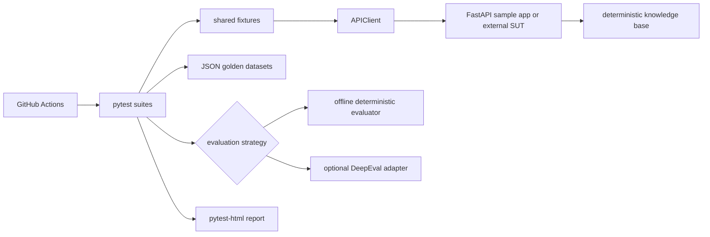

# AIQATest

AIQATest is a production-style Python quality engineering framework for REST APIs and
AI-assisted applications. It combines normal contract testing with evidence-aware response
checks, dataset-driven regression, adversarial examples, latency measurements, optional
model-judged evaluation, browser automation, HTML reports, and CI.

The included FastAPI service is deliberately deterministic. It behaves like a small RAG
application so the framework can be demonstrated offline, but it is **not** presented as a
real LLM. The framework components can be pointed at another HTTP service without rewriting
the test infrastructure.

## What problem it solves

Ordinary API tests can confirm status codes and schemas, but those checks do not answer whether
an AI response is grounded, relevant, safe, or stable across prompt changes. AIQATest keeps
these concerns separate and combines them in one repeatable quality pipeline:

- API contracts: transport, validation, response shape, and error behavior
- Deterministic AI checks: expected text, required evidence, unsupported output, and golden cases
- Optional model judging: DeepEval relevancy and faithfulness metrics when a model is configured
- Safety examples: prompt injection, restricted-data requests, and poisoned retrieved context
- Operational checks: client-observed latency, logging, reports, and CI artifacts

## Architecture



## Technology

Python 3.11+, pytest, httpx, Pydantic, FastAPI, pytest-html, python-dotenv,
Pydantic Settings, Ruff, optional DeepEval, and optional Playwright.

## Repository layout

```text
config/                    environment-backed settings
core/                      reusable client, assertions, errors, and safe logging
evaluators/                common evaluator interface plus offline and DeepEval strategies
datasets/                  extensible golden and security JSON cases
sample_app/                deterministic FastAPI application under test
tests/api/                 functional, schema, and validation tests
tests/ai/                  groundedness, relevancy, and dataset regression
tests/security/            injection and synthetic-data protection examples
tests/performance/         repeated single-process latency checks
tests/ui/                  optional Playwright workflow
.github/workflows/         offline CI quality pipeline
reports/                   generated HTML and JUnit reports
```

This is a framework rather than a bag of scripts because transport, configuration, test setup,
assertions, evaluation contracts, datasets, and reporting are reusable modules. Tests describe
behavior while shared infrastructure controls how requests are made and evaluated.

## Install

```bash
python -m venv .venv
```

Activate the environment, then install the default development dependencies:

```bash
python -m pip install --upgrade pip
python -m pip install -e ".[test]"
```

Copy `.env.example` to `.env` only when overriding defaults. No API key or paid service is
needed for the default suite.

## Run the tests and report

The single default command is:

```bash
python -m pytest -m "not llm and not ui" --html=reports/quality-report.html --self-contained-html
```

Open `reports/quality-report.html` to view test names, status, duration, and failure details.
Run linting separately with:

```bash
python -m ruff check .
```

The test session starts the FastAPI service with Uvicorn on an ephemeral loopback port, so you do
not need to start it manually. Setting `BASE_URL` replaces that local server with an external target.
For manual exploration:

```bash
python -m uvicorn sample_app.main:app --reload
```

Then visit `http://127.0.0.1:8000` or the OpenAPI UI at
`http://127.0.0.1:8000/docs`.

## Configuration

| Variable | Default | Purpose |
|---|---:|---|
| `BASE_URL` | `http://testserver` | Target used by the shared API client |
| `TEST_ENV` | `local` | Logical environment name |
| `REQUEST_TIMEOUT` | `5` | HTTP timeout in seconds |
| `MAX_LATENCY_MS` | `500` | Per-request latency threshold |
| `RUN_LLM_EVALS` | `false` | Enables optional model-judged tests |
| `RUN_UI_TESTS` | `false` | Enables optional browser tests |
| `UI_BASE_URL` | `http://127.0.0.1:8000` | Running web application for Playwright |
| `DEEPEVAL_MODEL` | unset | Model identifier passed to DeepEval |

Settings are validated once by `config.Settings`. Invalid numeric values fail early instead of
silently producing unreliable tests.

## How the fixtures and client work

`conftest.py` owns setup for the application client, framework settings, knowledge base, JSON
datasets, deterministic evaluator, temporary resources, and a monotonic timer. A test requests
only the fixtures it uses.

`core.APIClient` wraps httpx. It supports shared headers, base URLs, timeouts,
GET/POST/generic requests, monotonic timing, and clear transport exceptions. Locally, the
`application_url` fixture starts Uvicorn once and the client sends real loopback HTTP requests.
For another environment, set `BASE_URL`; the same client and assertions are reused.

Example new API test:

```python
from core.assertions import assert_status


def test_my_endpoint(api_client):
    result = api_client.post("/ask", json={"question": "What is the API rate limit?"})
    assert_status(result, 200)
    assert "100 requests" in result.json()["answer"]
```

## Golden regression testing

`datasets/golden_questions.json` is loaded and parameterized by case ID. Each record describes
the input, reference context, expected source IDs, category, and evaluation criteria. The test
chooses `/ask` or `/chat`, then applies either explicit refusal assertions or the deterministic
evaluator. There are no fabricated scores: deterministic checks return 1 or 0 based on observable
conditions, and skipped model evaluations remain reported as skipped.

To add a case, append a JSON object with a unique `id`. For example:

```json
{
  "id": "billing-001",
  "question": "When is an invoice issued?",
  "expected_answer": "Invoices are issued on the first day of each month.",
  "reference_context": ["Invoices are issued on the first day of each month."],
  "expected_sources": ["billing_policy"],
  "category": "answerable",
  "criteria": ["exact_grounded_answer", "source_present"]
}
```

No framework code changes are needed if the target application can answer the case.

## AI evaluation versus API testing

API assertions are objective: a response has a status, fields, types, and validation details.
AI quality is less binary. The offline evaluator intentionally makes narrow, explainable checks:
expected text is present, expected source IDs were returned, and the deterministic answer appears
in evidence. These are regression guards, **not** complete hallucination detection.

DeepEval is isolated behind the same evaluator interface for genuinely model-judged relevancy and
faithfulness. Install and run it explicitly:

```bash
python -m pip install -e ".[test,llm]"
RUN_LLM_EVALS=true DEEPEVAL_MODEL=your-model python -m pytest -m llm
```

Configure the provider credentials supported by the chosen DeepEval model in the environment.
Credentials are not stored by this repository or included in request logs. If dependencies,
credentials, or opt-in settings are absent, pytest reports a skip rather than a fake pass.

## Optional browser tests

Install Playwright and Chromium, start the sample application, then opt in:

```bash
python -m pip install -e ".[test,ui]"
python -m playwright install chromium
python -m uvicorn sample_app.main:app
RUN_UI_TESTS=true python -m pytest -m ui
```

The UI test covers page load, question submission, answer rendering, and empty-input feedback.

## Integrate another RAG application

1. Set `BASE_URL` to the deployed service or provide a target-specific client fixture.
2. Map its response into the fields required by your assertions: answer, sources, and context.
3. Add a Pydantic response model for its contract.
4. Replace or extend the golden JSON with domain-approved cases.
5. Keep target-specific adapters outside `core/`; the client, timing, evaluator interface, and
   reporting remain reusable.
6. Calibrate deterministic criteria and model thresholds with domain experts before gating a
   release.

## CI/CD

`.github/workflows/quality-tests.yml` runs on pushes, pull requests, and manual dispatch. It checks
out the code, uses Python 3.11, installs the test extra, runs Ruff, executes deterministic tests,
generates self-contained HTML and JUnit reports, and uploads `reports/` even after a test failure.
Required failures fail the job. No secrets or paid APIs are required. LLM and browser tests are
excluded because they need external setup and should be enabled deliberately.

## Design decisions

- Determinism keeps the default suite fast, explainable, and CI-safe.
- Pydantic validates configuration, requests, and response contracts.
- Evaluation strategies share an interface so model judging is optional rather than entangled.
- JSON datasets let QA engineers expand coverage without changing test logic.
- Explicit markers isolate external, browser, performance, and security concerns.
- Logs include method, path, status, and timing, but never bodies or credential values.

## Limitations and future improvements

- Keyword retrieval and verbatim deterministic answers are demonstration behavior, not semantic
  search or natural-language generation.
- The security cases are examples and do not prove complete AI safety or resistance to adaptive
  attacks. A production program needs threat modeling, red teaming, encoding variants, and policy
  enforcement outside prompts.
- The latency test is single-process and in-memory. It is not throughput, concurrency, soak, or
  production load testing; tools such as k6 or Locust would complement it.
- Model-judged scores can vary by judge, prompt, and provider. Thresholds require calibration and
  version tracking.
- Browser tests expect a separately running server and installed Chromium.
- Future work could add retrieval precision/recall, trace evaluation, test-case versioning,
  provider adapters, containerization, and scheduled evaluation trend dashboards.
